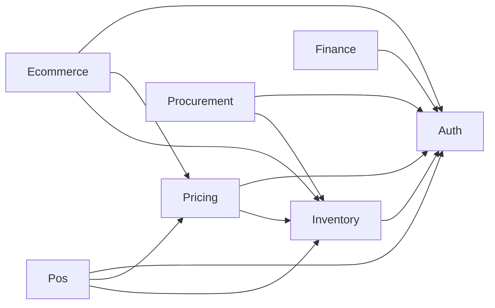
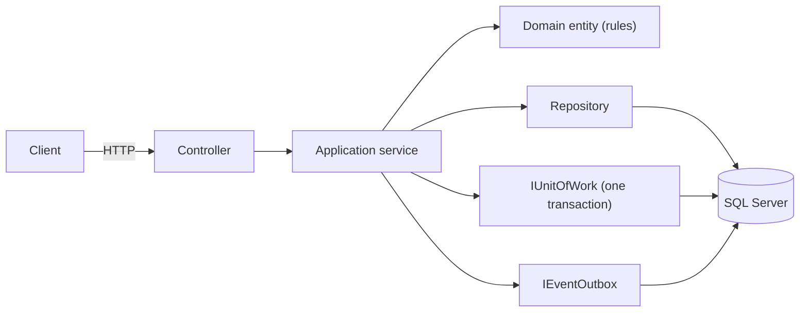
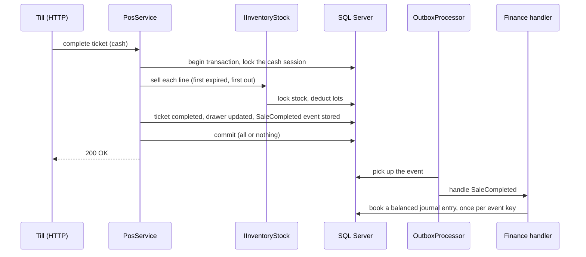

# Supermarket ERP API

**Frontends**

- ERP back office: https://github.com/Maher-Khemakhem/ERP_frontend
- Customer storefront: https://github.com/Maher-Khemakhem/storefront

The Supermarket ERP API is the backend for a supermarket operations platform. It provides the shared services used by the staff ERP application and the customer storefront, keeping products, stock, sales, purchasing, finance, and online orders in one system.

## What the API does

- Manages products, inventory, prices, and promotions.
- Supports in-store sales, tills, and cash sessions.
- Tracks suppliers, purchase orders, goods receiving, invoices, and financial records.
- Provides a customer catalog, shopping carts, and online orders.
- Integrates with Stripe test checkout for online payments.
- Protects staff and customer actions with JWT authentication and role-based permissions.

The backend is a .NET 10 ASP.NET Core modular monolith: one API process organized into feature areas such as Auth, Inventory, POS, Procurement, Finance, and Ecommerce. SQL Server stores application data. Background workers process financial events and expire unpaid online orders.

## Run locally

### Requirements

- .NET 10 SDK
- Docker Desktop
- A SQL Server client such as SQL Server Management Studio or Azure Data Studio

From the repository root, start the local SQL Server container:

```powershell
$env:MSSQL_SA_PASSWORD = "Choose-a-strong-local-password-123!"
docker compose -f docker-compose.sqlserver.yml up -d
```

Connect to `localhost,1433` as `sa` with that password and create the application database if it does not already exist:

```sql
CREATE DATABASE supermarket_erp_saas_dev;
```

Create the API's local environment file:

```powershell
Copy-Item backend-.net/SupermarketErp.Api/.env.example backend-.net/SupermarketErp.Api/.env
```

Edit `.env` and set `JWT_SECRET` to at least 32 random characters. Set `DB_PASSWORD` to the same password used for the SQL Server container. The `.env` file is ignored by Git; do not commit secrets.

Run the API from the repository root:

```powershell
$env:ASPNETCORE_ENVIRONMENT = "Development"
dotnet run --project backend-.net/SupermarketErp.Api
```

If Windows blocks the generated application executable, run it through the .NET host:

```powershell
dotnet run --project backend-.net/SupermarketErp.Api -p:UseAppHost=false
```

The API listens on `http://localhost:8080`.

- Interactive API explorer: [http://localhost:8080/swagger](http://localhost:8080/swagger) (Development only)
- OpenAPI document: [http://localhost:8080/openapi/v1.json](http://localhost:8080/openapi/v1.json) (Development only)
- Liveness check: [http://localhost:8080/health/live](http://localhost:8080/health/live)
- Database readiness check: [http://localhost:8080/health/ready](http://localhost:8080/health/ready)

On a fresh database, create the first administrator with `POST /api/auth/register` before allowing customer registration. Protected endpoints require a bearer token; the registration and login responses include one.

## Database changes

The API applies pending SQL migrations at startup and records them in `platform.schema_migrations`. The initial schema is in `SupermarketErp.Api/Migrations/0001_initial.sql`. Add a new numbered file for each future schema change, such as `0002_add_product_barcode.sql`; do not edit a migration already applied to a shared database. Migration scripts run as a single SQL Server batch inside a transaction, so do not use `GO` separators. See [the migration guide](SupermarketErp.Api/Migrations/README.md).

## Architecture

Each feature area under `SupermarketErp.Api/Features/` is a module with the same four layers:

| Layer | Holds | May depend on |
|---|---|---|
| `Domain` | Entities that enforce their own rules (a ticket completes once, a journal entry must balance). Plain C#. | Nothing else |
| `Application` | Services that run one use case in one transaction, and the interfaces they need. | Its own domain, `IUnitOfWork`, `IEventOutbox`, and the public contracts of other modules |
| `Infrastructure` | Repositories. They load and store entities and contain no business rules. | EF Core |
| `Presentation` | Controllers and endpoints. They call application services only. | Application |

How the pieces work together:

- **One database, clear boundaries.** All modules share one `BusinessDbContext` so a sale can commit POS and stock changes atomically. A module touches only its own tables and calls other modules through their contracts (`IInventoryStock`, `IPricingCalculator`, `IAuthService`). Architecture tests enforce this.
- **Transactions.** Application services run inside `IUnitOfWork.InTransaction`, which saves and commits once. If SQL Server picks the transaction as a deadlock victim, the whole unit of work is run again (up to 4 attempts). Hot rows (a product's stock level, a cash session) are loaded with an update lock so concurrent sales queue up instead of deadlocking.
- **Events.** A service publishes an event with `IEventOutbox.Publish`; it is stored in `platform.dotnet_outbox` in the same transaction as the business change. `OutboxProcessor` delivers events at least once, in order, to the `IOutboxHandler` that the owning module registered (for example, Finance books sales and receipts, Procurement raises low-stock alerts). Failed events are retried with backoff and dead-lettered after 5 attempts, so handlers must be idempotent.
- **Errors.** Business failures throw `DomainValidationException` (HTTP 400) or `ConflictException` (HTTP 409). Anything else is a bug and returns 500 with the error logged. Unique and foreign key violations return 409.

### Modules and who may call whom



An arrow means "may call the public contract of". There are no cycles, and Finance and Procurement never call POS or each other: they learn about sales and receipts only through events. The architecture tests fail the build if a module breaks these rules.

### How a request flows



### Example: a cash sale



The sale and its event commit together, so a failure never leaves stock deducted without a ticket, or a ticket without its event. The books are updated a moment later by the handler; if it fails, the event is retried.

### Shared pieces

| Piece | Location | Role |
|---|---|---|
| `IUnitOfWork`, `IEventOutbox`, `OutboxProcessor`, `IOutboxHandler` | `Infrastructure/` | Transactions, deadlock retry, and event delivery. They know nothing about module tables. |
| `DomainValidationException`, `ConflictException` | `Shared/` | The only exceptions that become 400 and 409 responses. |
| `ApiExceptionMiddleware` | `Infrastructure/` | Turns exceptions into the standard error response. |
| Architecture tests | `SupermarketErp.Api.Tests/ModuleBoundaryTests.cs` | Enforce module dependencies, layer rules, exception use, and one handler per event. |

### Known gaps

- `StripeCheckout`, `AuthService`, `InventoryStock` and `PricingService` still use the database context directly. A test stops this list from growing.
- Stock rules (first-expired-first-out) live in `InventoryStock`, not in a stock aggregate.
- Phone scanner pairings are kept in memory and are lost on restart.

## Tests

The integration tests start the real API against a throwaway SQL Server database (`supermarket_erp_test_<guid>`, created and dropped by each test class), so SQL Server must be running. They use the server from `TEST_DB_CONNECTION_STRING` if set, otherwise the `DB_*` settings in `SupermarketErp.Api/.env`.

```powershell
dotnet test backend-.net/SupermarketErp.Api.Tests
```

They cover the main flows (sales, receipts, online orders, finance, the outbox), concurrent sales, and the architecture rules above. Tests run one at a time because they set process-wide environment variables.

If Windows application control blocks the freshly built test or API DLL (`FileLoadException ... 0x800711C7`), change any string in the code and rebuild.

## Configuration

The API reads settings from environment variables or the local `.env` file. See [`SupermarketErp.Api/.env.example`](SupermarketErp.Api/.env.example) for the full template.

| Setting | Required | Purpose |
|---|---:|---|
| `JWT_SECRET` | Yes | Signs authentication tokens; must be at least 32 bytes. |
| `DB_CONNECTION_STRING` | No | Complete SQL Server connection string; takes precedence over the individual database settings. |
| `DB_HOST`, `DB_PORT`, `DB_NAME` | No | SQL Server address and database name. |
| `DB_USERNAME`, `DB_PASSWORD` | No | SQL Server credentials. |
| `APP_UPLOAD_DIR` | No | Persistent directory for product images. |
| `CORS_ALLOWED_ORIGINS` | In production | Comma-separated browser origins allowed to call the API (for example `https://erp.example.com`). Development allows local origins automatically; elsewhere, unlisted origins are blocked. |
| `STRIPE_SECRET_KEY`, `STRIPE_WEBHOOK_SECRET`, `STRIPE_TND_TO_EUR_RATE` | No | Stripe test checkout settings. |
| `STRIPE_STOREFRONT_RETURN_BASE_URL` | No | Storefront URL used after checkout. |

## Build

From the repository root:

```powershell
dotnet build backend-.net/SupermarketErp.Api/SupermarketErp.Api.csproj
```

## Related project

The staff web application is available at [ERP_frontend](https://github.com/Maher-Khemakhem/ERP_frontend).
