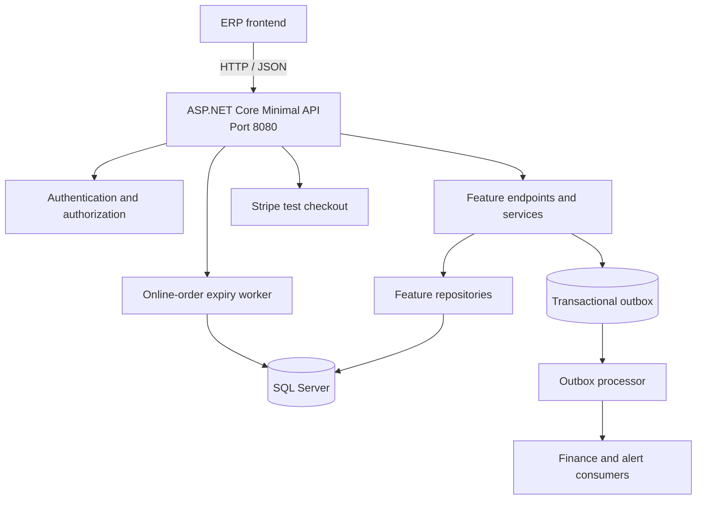

[Frontend repository](https://github.com/Maher-Khemakhem/ERP_frontend)

# Supermarket ERP .NET API

This directory contains the ASP.NET Core backend for Supermarket ERP. It is a .NET 10 Minimal API organized by feature folders and backed by SQL Server.

## Requirements

- .NET 10 SDK
- Docker Desktop (for the local SQL Server container)
- SQL Server 2022 or a compatible SQL Server instance

## Local setup

From the repository root, start SQL Server:

```powershell
$env:MSSQL_SA_PASSWORD = "Use-a-local-development-password-123!"
docker compose -f docker-compose.sqlserver.yml up -d
```

The password must satisfy SQL Server complexity requirements. Do not commit it or use it in a shared environment.

Create the local environment file:

```powershell
Copy-Item backend-.net/SupermarketErp.Api/.env.example backend-.net/SupermarketErp.Api/.env
```

Edit `backend-.net/SupermarketErp.Api/.env` and set at least:

```text
JWT_SECRET=at-least-32-random-characters
DB_HOST=localhost
DB_PORT=1433
DB_NAME=supermarket_erp_saas_dev
DB_USERNAME=sa
DB_PASSWORD=the-same-password-used-for-the-container
```

The `.env` file is ignored by Git. Process environment variables take precedence over values loaded from this file. A complete template, including optional Stripe settings, is available in [`SupermarketErp.Api/.env.example`](SupermarketErp.Api/.env.example).

Run the API from the repository root:

```powershell
dotnet run --project backend-.net/SupermarketErp.Api
```

The API listens on `http://localhost:8080`. OpenAPI is available at [`/openapi/v1.json`](http://localhost:8080/openapi/v1.json) in Development. Health endpoints are:

- [`/health/live`](http://localhost:8080/health/live) — confirms that the process is running.
- [`/health/ready`](http://localhost:8080/health/ready) — confirms that SQL Server is reachable.

At startup, the API creates its identity tables and the `platform.dotnet_outbox` table if they do not already exist. Business tables must be present in the configured SQL Server database.

## Architecture

The backend is a modular monolith. It runs as one ASP.NET Core process, while feature folders keep authentication, business workflows, and persistence responsibilities separated.



### Application layers

- **API layer** — Minimal API endpoint groups under `Features/*` map HTTP requests, apply authorization policies, validate input, and return JSON responses.
- **Application and domain layer** — Feature services coordinate use cases and enforce business rules for inventory, pricing, POS, procurement, finance, and ecommerce.
- **Infrastructure layer** — `Infrastructure/` provides SQL Server access, environment-file loading, JWT-related startup configuration, exception handling, and background processing.
- **Persistence layer** — Feature repositories use `Microsoft.Data.SqlClient` to read and write SQL Server. Cross-feature identifiers are passed explicitly rather than through shared entity relationships.

### Feature boundaries

The main feature areas are:

- **Auth** — setup, users, BCrypt password verification, JWTs, roles, and login rate limiting.
- **Inventory** — products, product families, stock, receiving, and product images.
- **Pricing** — product prices and promotions.
- **POS** — tills, cash sessions, sales, payments, voids, and scanner pairing.
- **Procurement** — suppliers, purchase orders, receiving, and low-stock alerts.
- **Finance** — journals, ledger entries, supplier invoices, payments, and settlements.
- **Ecommerce** — storefront catalog, carts, online orders, reservations, and Stripe test checkout.

Feature code should use another feature's public service or an outbox event instead of accessing its repository directly.

### Authentication and request flow

Most routes require a JWT bearer token. The API validates the token issuer, audience, signature, and lifetime, then maps the `roles` claim to the configured authorization policies. Public routes are limited to setup status, registration/login, health checks, development OpenAPI, storefront access where configured, and scanner endpoints authenticated by their pairing token.

For a normal authenticated request:

1. The frontend sends JSON and a bearer token to an `/api` route.
2. ASP.NET Core authenticates the token and applies the endpoint's role policy.
3. The feature endpoint calls its application service or repository.
4. The operation reads or updates SQL Server inside the required transaction.
5. Any cross-feature event is stored in the transactional outbox before the request completes.

### Background processing

The outbox processor retries pending events and supports idempotent event handling. The online-order expiry worker periodically finds unpaid expired orders and releases their reservations. Both workers run inside the API host and use the same SQL Server database as the request pipeline.

## Configuration

The API accepts either a complete `DB_CONNECTION_STRING` or these database settings:

| Variable | Required | Description |
|---|---:|---|
| `JWT_SECRET` | Yes | JWT signing secret containing at least 32 bytes |
| `JWT_ISSUER` | No | JWT issuer; defaults to `supermarket-erp` |
| `JWT_AUDIENCE` | No | JWT audience; defaults to `supermarket-web` |
| `DB_CONNECTION_STRING` | No | Complete SQL Server connection string |
| `DB_HOST` | No | SQL Server host; defaults to `localhost` |
| `DB_PORT` | No | SQL Server port; defaults to `1433` |
| `DB_NAME` | No | Database name; defaults to `supermarket_erp_saas_dev` |
| `DB_USERNAME` | No | Database user; defaults to `sa` |
| `DB_PASSWORD` | No | Database password |
| `APP_UPLOAD_DIR` | No | Product image directory; defaults to `uploads/products` |
| `STRIPE_SECRET_KEY` | No | Stripe test-mode secret key |
| `STRIPE_WEBHOOK_SECRET` | No | Stripe webhook signing secret |
| `STRIPE_TND_TO_EUR_RATE` | No | TND-to-EUR conversion rate for test checkout |
| `STRIPE_STOREFRONT_RETURN_BASE_URL` | No | Storefront URL used after Stripe checkout |

`JWT_SECRET` is validated when the application starts. Stripe settings are only needed for Stripe test checkout.

## API areas

All protected business routes use the `/api` prefix and require a bearer JWT unless noted otherwise.

- `/api/auth` — setup, login, customer login, and user administration.
- `/api/inventory` — products, product families, stock, receiving, and product images.
- `/api/pricing` — product prices and promotions.
- `/api/pos` — tills, cash sessions, transactions, payments, voids, and scanner pairing.
- `/api/procurement` — suppliers, purchase orders, receiving, and low-stock alerts.
- `/api/finance` — ledger, journals, supplier invoices, payments, and card settlements.
- `/api/store` — customer catalog, cart, and online checkout.
- `/api/online-orders` — staff management of online orders.
- `/api/store/stripe` — Stripe test checkout and webhook handling.

The first registration creates an administrator when no users exist. Subsequent user administration requires the `ADMIN` role. Other roles are `MANAGER`, `CASHIER`, `INVENTORY_MANAGER`, `ACCOUNTANT`, and `CUSTOMER`.

## Runtime behavior

- Authentication uses BCrypt password verification and JWT bearer tokens.
- SQL Server access uses `Microsoft.Data.SqlClient`.
- Domain events are written to the SQL Server transactional outbox and processed by a hosted worker.
- Online orders have a hosted expiry worker that releases reservations for unpaid orders.
- Product images are stored outside the database. Set `APP_UPLOAD_DIR` to a persistent directory in deployed environments.
- Stripe integration is test-mode only and validates webhook signatures.
- Development CORS permits local HTTP/HTTPS origins. Configure the reverse proxy and allowed origins appropriately for production.

## Build

Build the API:

```powershell
dotnet build backend-.net/SupermarketErp.Api/SupermarketErp.Api.csproj
```

## Container image

Build the .NET image from the repository root:

```powershell
docker build -f Dockerfile.backend-dotnet -t supermarket-erp-api .
```

The image listens on port `8080` and stores product uploads under `/data/uploads/products`. Mount a persistent volume at that path and provide the database and JWT settings as environment variables when running the container.

## Project layout

```text
backend-.net/
  SupermarketErp.Api/
    Features/
      Auth/
      Ecommerce/
      Finance/
      Inventory/
      Pos/
      Pricing/
      Procurement/
    Infrastructure/
    Program.cs
    SupermarketErp.Api.csproj
```

Feature endpoints and application services should remain within their feature area. Shared infrastructure belongs under `Infrastructure/`, and cross-feature workflows should use explicit application services or outbox events rather than reaching into another feature's persistence details.

## Related applications

- [`supermarket-erp`](../supermarket-erp/) — staff web application.
- [`supermarket-storefront`](../supermarket-storefront/) — customer storefront.
- [`docker-compose.sqlserver.yml`](../docker-compose.sqlserver.yml) — local SQL Server service.
- [`Dockerfile.backend-dotnet`](../Dockerfile.backend-dotnet) — production container image.
